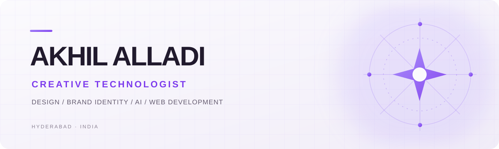

  

<h1 align="center">Creative Technologist</h1>

<h3 align="center">Graphic Designer | Brand Identity | AI &amp; Web Development</h3>

  I bring together visual design, brand thinking and technology to create meaningful identities, useful digital experiences and thoughtful creative work.

  <a href="https://github.com/akhilalladi-code">GitHub</a> ·
  <a href="https://www.linkedin.com/in/akhil-alladi/">LinkedIn</a> ·
  <a href="https://www.behance.net/akhil_alladi">Behance</a> ·
  <a href="https://akhilalladi-code.github.io/akhil-alladi-portfolio/">Portfolio</a> ·
  <a href="mailto:akhilalladi@gmail.com">Email</a> ·
  <a href="https://youtube.com/@akhilalladi">YouTube</a>

---

## About me

I'm a Hyderabad-based graphic designer working across brand identity, visual communication and digital experiences. I enjoy turning ideas into clear visual systems — from the first concept and creative direction to polished campaign assets and practical design applications.

Alongside design, I explore web development, generative AI and automation. I’m interested in the space where creative thinking and technology meet: building tools, improving workflows and finding more useful ways to communicate ideas.

- **Design:** Brand identity, visual systems, campaign design and digital content
- **Creative technology:** Web projects, AI-assisted creative workflows and practical experiments
- **Industry experience:** Solar and electrical-sector branding and communication
- **Location:** Hyderabad, India

## Professional experience

### Graphic Designer — Indosol Solar Private Limited

Working across brand identity, visual communication and marketing design in the solar industry.

- Develop day-to-day creative assets, campaign graphics, promotional materials and digital content.
- Contribute to brand identity and rebranding projects, translating brand direction into consistent visual applications.
- Create communication materials for solar and electrical-sector initiatives, including corporate and event campaigns.
- Work across concept development, layout, typography, image treatment and final production.

## Selected experience & highlights

- Completed branding work for **two companies** and contributed to the rebranding of an established **30-year-old company**.
- Created a range of marketing and communication assets, including social creatives, promotional graphics, thumbnails, logos and corporate collateral.
- Developed a design-focused portfolio website and a separate showcase for selected graphic design work.

## What I do

| Brand & visual design | Creative technology |
| --- | --- |
| Brand identity and logo design | Web experiences and small digital tools |
| Typography, colour and layout systems | AI-assisted creative exploration |
| Marketing campaigns and social media | Workflow and process experimentation |
| Brochures, posters and corporate communication | Design-focused product thinking |

## Featured projects

### [Akhil Alladi — Design Portfolio](https://akhilalladi-code.github.io/akhil-alladi-portfolio/)

My primary professional portfolio: an editorial-style showcase of design work, project case studies, services, experience and contact information.

**Built with:** Next.js 15 · React 19 · TypeScript · Tailwind CSS v4 · Framer Motion

[View portfolio ↗](https://akhilalladi-code.github.io/akhil-alladi-portfolio/) · [View source ↗](https://github.com/akhilalladi-code/akhil-alladi-portfolio)

### [Graphic Design Showcase](https://akhilalladi-code.github.io/graphic-design-showcase/)

A curated archive of brand communication, event campaigns, social media creatives, corporate collateral and broadcast graphics. It also includes Framecheck, a browser-based tool for previewing social creative dimensions, crops and safe areas.

**Built with:** HTML · CSS · JavaScript

[Explore showcase ↗](https://akhilalladi-code.github.io/graphic-design-showcase/) · [View source ↗](https://github.com/akhilalladi-code/graphic-design-showcase)

## Tools & technologies

**Design**

Adobe Photoshop · Adobe Illustrator · Canva

**Web & development**

HTML · CSS · JavaScript · React · Next.js · TypeScript · Tailwind CSS

**Exploration**

Generative AI · AI-assisted creative workflows · Workflow automation

## GitHub overview

  
  

## Contribution activity

  

## Certifications & learning

- **Certified Generative AI Manager**
- **ChatGPT Master: Complete OpenAI ChatGPT Course** — Udemy
- **Essential Skills in Adobe Photoshop 2025 Professional Certificate** — LinkedIn Learning
- **AI Tools Workshop** — Be10x

*Credential verification links can be added when the public certificate URLs are available.*

## Let's connect

I'm always glad to connect with designers, creative teams, developers and people exploring thoughtful ways to use technology.

  <a href="https://github.com/akhilalladi-code">GitHub</a> ·
  <a href="https://www.linkedin.com/in/akhil-alladi/">LinkedIn</a> ·
  <a href="https://www.behance.net/akhil_alladi">Behance</a> ·
  <a href="https://akhilalladi-code.github.io/akhil-alladi-portfolio/">Portfolio</a> ·
  <a href="mailto:akhilalladi@gmail.com">Email</a> ·
  <a href="https://youtube.com/@akhilalladi">YouTube</a>

<em>Design with purpose. Build with curiosity.</em>

---

GitHub statistics and contribution visualizations are provided by external services and may occasionally be unavailable or rate-limited.
