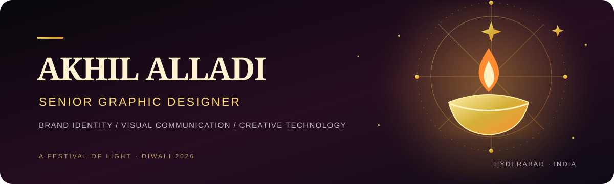

  <a href="https://akhilalladi-code.github.io/diwali-universe/"><strong>🪔 ENTER MY DIWALI UNIVERSE 2026 · INTERACTIVE FIREWORKS & DIYAS ↗</strong></a>

  <a href="https://www.linkedin.com/in/akhil-alladi/">LinkedIn</a> ·
  <a href="https://www.behance.net/akhil_alladi">Behance</a> ·
  <a href="https://github.com/akhilalladi-code">GitHub</a> ·
  <a href="https://akhilalladi-code.github.io/akhil-alladi-portfolio/">Portfolio</a>

# Hi, I'm Akhil Alladi 👋

**Senior Graphic Designer focused on brand identity, visual communication, and marketing design.**

I create thoughtful visual systems and communication materials that help brands present themselves with clarity and consistency. My work includes brand identity, logo design, corporate communication, marketing campaigns, social media creatives, brochures, posters, and digital design.

My professional focus is design. AI tools, web development, and automation are complementary interests I explore through personal projects.

---

## 🪔 Diwali Universe 2026

A small celebration built with code: interactive Canvas fireworks, glowing diyas, optional sound and shareable festive greetings.

**[Launch the Diwali Universe](https://akhilalladi-code.github.io/diwali-universe/)** · [Celebrate](https://akhilalladi-code.github.io/diwali-universe/celebrate.html) · [Create a greeting](https://akhilalladi-code.github.io/diwali-universe/wishes.html)

## Design practice

| Brand & Identity | Marketing & Campaigns |
|---|---|
| Logo design and visual identity systems | Campaign concepts and promotional creatives |
| Brand guidelines and brand applications | Social media and digital advertising |
| Typography, colour, and layout systems | Posters, brochures, and presentations |
| Consistent visual communication | Corporate and event communication |

## Creative toolkit

**Core tools:** Adobe Photoshop · Adobe Illustrator · Canva · Adobe Creative Cloud

**Complementary interests:** Generative AI for creative exploration · Web technologies · Workflow automation

## Featured work and projects

- [Primary graphic design portfolio](https://akhilalladi-code.github.io/akhil-alladi-portfolio/)
- [Netflix-inspired creative portfolio](https://akhilalladi-code.github.io/akhil-alladi-netflix-portfolio/)
- [Graphic design project archive](https://akhilalladi-code.github.io/graphic-design-showcase/)
- [Claude Code learning handbook](https://akhilalladi-code.github.io/claude-code-at-zero-cost/)

## Professional profile

- **LinkedIn:** [Akhil Alladi](https://www.linkedin.com/in/akhil-alladi/)
- **Behance:** [Akhil Alladi](https://www.behance.net/akhil_alladi)
- **GitHub:** [@akhilalladi-code](https://github.com/akhilalladi-code)

## Beyond design

I enjoy experimenting with AI-assisted workflows, frontend development, and automation. These personal explorations help me understand new tools and bring fresh possibilities into my creative process; they are not my primary professional role.

---

## Let's connect

- **LinkedIn:** [Akhil Alladi](https://www.linkedin.com/in/akhil-alladi/)
- **Email:** [akhilalladi@gmail.com](mailto:akhilalladi@gmail.com)

---

*Designing with purpose. Building identities with clarity. Staying curious about what's next.* 🎨
